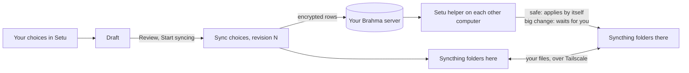

<div align="center">
  
  <h1>Setu</h1>
  <h4>Choose exactly which files and folders sync between your computers, and which way they go.</h4>

  <p>
    
    
    
  </p>

  <p>
    <a href="#-what-it-does">What it does</a> •
    <a href="#-get-started">Get started</a> •
    <a href="#-how-it-works">How it works</a> •
    <a href="#-faq">FAQ</a> •
    <a href="#-for-developers">For developers</a>
  </p>
</div>

Setu is for anyone who keeps one work folder on several computers but does not want *everything*
to go both ways. For example: send all of your laptop's projects to your desktop, but only
let one or two folders come back. Setu shows both computers' files side by side, lets you set a
direction on any folder or file, and shows you exactly what will change before anything does.

Setu is **alpha** software. Files are copied by [Syncthing](https://syncthing.net)'s code, built
into Setu, straight from computer to computer over [Tailscale](https://tailscale.com). Setu tells
it what to do. Nothing else needs to be installed or running. Your computers find each other through your **Brahma account**: you
make your choices once, on any computer, and the others set themselves up. It works with up to
eight computers.

> [!WARNING]
> Setu never deletes files when you change a direction or switch a folder off. But Syncthing
> *does* pass deletions along inside a folder that syncs. If you delete a file in a folder set
> to "Both ways", it goes on the other computer too. Syncthing keeps old copies for 30 days in
> each folder's `.stversions` folder, so you can get them back.

## ✨ What it does

- 🧭 **A direction for every folder and file** – *Copy from Windows*, *Copy to Windows*, *Both
  ways* or *Don't sync*, set with one click. Everything inside a folder follows it unless you
  choose otherwise. (Setu names the other computer by its system, so on Windows it says *Linux*.)
- ⚡ **Quick setup in two steps** – pick "copy everything from the other computer", "copy
  everything to it" or "keep both the same", then untick the folders to leave out. Folders are
  listed biggest first, with sizes, so large projects are easy to spot.
- 👀 **Both computers in one view** – see what is here, what is there and what is only on one
  side, with sizes, before you decide.
- 📝 **See before you change** – your choices stay a draft until you open the review, read the
  plan and press **Start syncing**.
- 🔒 **Secrets never travel** – API key folders, `.env` files and signing keys are always left
  out, whatever you choose. Build and cache folders are left out too.
- 🤝 **Choose once, every computer follows** – your choices are shared through your Brahma
  account, locked end to end so only your computers can read them. Each computer's Setu sets
  itself up within a minute or two. Only a change that would replace or remove many files waits
  for you on that computer, and the top bar says which one.
- 🔗 **No pairing by hand** – sign in on a new computer and Setu adds your other computers to
  Syncthing for you, at their Tailscale addresses only. Syncthing's internet discovery and relays
  are switched off.
- 💾 **Backup copies** – mark a computer as a backup and it only receives. Changes made there are
  never sent back.
- 🧮 **Same files everywhere?** – every few hours Setu reads every synced file on each computer
  and compares fingerprints (SHA-256). It tells you when a folder holds exactly the same files on
  all computers, and when not, which files differ.
- 🧹 **No duplicate copies left behind** – a conflict copy or old version that is exactly the same
  as its file is removed, only after three checks: same size, same SHA-256 and every byte
  compared. Your own files are never touched. Every removal is listed and can be put back.
- 📊 **Progress in plain words** – the bottom bar shows what is still copying ("Copying to this
  computer: 1,204 files (3.1 GB) left") and says when everything is copied.
- ↩️ **Nothing lost by changing your mind** – switching a folder off stops syncing it; the files
  stay on both computers.
- 🧱 **Starts with nothing synced** – nothing moves until you choose it.
- 🔍 **File-by-file preview** – before the first sync, Setu compares both computers' file lists
  and shows how many files go each way, which ones get replaced, and which stay on one side.
  If many files would be replaced, it asks a second time.
- 🪟 **Windows name check** – names Windows cannot hold (`CON`, `a:b`, trailing dots, very long
  paths, two names that differ only in case) are listed before anything copies.
- 🛑 **Delete guard** – if more than 50 files are deleted on the other computer within two
  minutes, Setu pauses that folder here and tells you, until you resume it.
- 📶 **Network gate** – syncing waits on a metered connection or a slow relayed link, unless you
  allow it.
- ⚖️ **Conflicts, side by side** – when a file changed on both computers, both copies are kept;
  pick the one you want, and the other is put away, not deleted.
- 🕰️ **Old versions for 30 days** – put back any replaced or deleted file from a list.
- ✅ **Is it all copied?** – one click shows, folder by folder, that every file is complete and
  identical on both computers, or what is still missing and why.
- ⏸️ **Pause** – stop copying on this computer for an hour, until tomorrow morning, or until you
  resume. Changes on either side wait and are copied afterwards.
- 🚫 **Leave out by name** – add a name or pattern, such as `*.iso` or `videos`, and it is never
  copied, in any folder, on either computer.
- 🔔 **Notifications and tray** – a desktop notice when a folder is paused, a conflict appears or
  files cannot sync.

## 🚀 Get started

You need:

- A Brahma account on your own Brahma server (see
  [Brahma](https://github.com/sudharamachandranrajeev/brahma-life-suite)). It only holds your
  choices and each computer's status, encrypted. Your files never go through it.
- [Tailscale](https://tailscale.com/download) on every computer, signed in to the same account.
  On Linux the install command below sets it up for you.

1. **Install Setu on each computer.**

   **Windows:** download `Setu-…-windows-x64-setup.exe` from the
   [Releases page](https://github.com/sudharamachandranrajeev/setu-sync-manager/releases) and
   run it. It is not code-signed yet, so Windows SmartScreen may warn: choose **More info**, then
   **Run anyway**.

   **Linux (Arch, Omarchy, Ubuntu, Debian, Fedora):** open a terminal (on Omarchy:
   `Super + Enter`), paste this line and press Enter:

   ```sh
   curl -fsSL https://raw.githubusercontent.com/sudharamachandranrajeev/setu-sync-manager/main/install-linux.sh | bash
   ```

   That is all. Type your password when it asks. The command:

   1. installs the few libraries Setu's window needs (on Arch and Omarchy:
      `sudo pacman -S --needed webkit2gtk-4.1 gtk3 libayatana-appindicator`);
   2. installs and starts Tailscale if it is missing. If this computer is not signed in to
      Tailscale yet, it shows a link: open it and sign in with the same account as your other
      computers;
   3. downloads the newest Setu and checks the download is not damaged (SHA-256);
   4. installs Setu for you only, in `~/.local/bin`, adds it to the app menu (on Omarchy:
      `Super + Space`, type *Setu*) and opens it.

   Options go after `bash -s --`, for example
   `curl -fsSL …/install-linux.sh | bash -s -- --no-autostart`:
   `--no-autostart` (do not start Setu at login), `--no-deps` (skip steps 1 and 2) and
   `--uninstall` (remove Setu; your rules, settings and files stay). Want to read it first? It is
   [install-linux.sh](install-linux.sh), about 130 lines.

   Both start Setu at sign-in, in the background. Setu syncs only while it runs: it copies the
   files, sets up new choices, pairs your computers, checks the copies, pauses syncing on a
   metered network, stops mass deletions and shows notifications. Closing the window keeps it
   running in the tray; **Quit Setu** in the tray stops it.

   Used Syncthing before, or an earlier Setu? On first start Setu offers to move that setup
   inside. This computer keeps its Syncthing identity, so your other computers keep syncing with
   it. Nothing is removed until the move has been checked.
2. **Open Setu and pick the folder to manage** (for example `/home/you/Work` or `C:\Work`).
3. **Sign in** with your Brahma server address, email and password.
4. **Say how this computer takes part:** *Keep the same files as my other computers*, or *Backup
   copy* (only receives).
5. **Choose what to copy, on any one computer.** Press **Quick setup** for the two-step version,
   or click any folder or file and choose on the right. Then press **Review**, read what will
   happen and press **Start syncing**.
6. **That's it.** Your other computers pick up the choices by themselves. If a change would
   replace or remove many files on one of them, that computer shows a notice and waits for you to
   check it there. The bottom bar shows the progress.

Prefer the terminal? `setu sign-in <server> <email>`, `setu join`, `setu rule …` and
`setu apply` do the same (`setu help` lists everything). They talk to the running Setu.

## ⬆️ Updating

### From 0.1.0-alpha.5 onwards: inside Setu

Setu checks for a new version twice a day. When one is out, you get a notification, and Setu
shows **Setu X is available** at the top of its window. Press **Update now**. Setu downloads
the new version, checks its signature, closes for a moment and starts again. You can also go to
the settings pane on the right, under **Updates**, and press **Check for updates**.

Your rules, settings, this computer's sync identity and your files are kept. Setu installs only
downloads signed with its release key. If the signature does not match, it installs nothing
and tells you.

On Linux, running the install command again also updates Setu, and keeps your start-at-login
choice:

```sh
curl -fsSL https://raw.githubusercontent.com/sudharamachandranrajeev/setu-sync-manager/main/install-linux.sh | bash
```

### From 0.1.0-alpha.4 or older: once

Those versions have no updater, and Syncthing still ran as its own program. Do this once on
each computer. Your computers keep syncing with each other while you go through them one by one.

1. **Make sure Tailscale is running** and signed in on that computer.
2. **Install the new version over the old one.**
   - **Windows:** download `Setu-…-windows-x64-setup.exe` from the
     [Releases page](https://github.com/sudharamachandranrajeev/setu-sync-manager/releases) and
     run it. It stops the old background helper and removes `setu-watch.exe` and its "Setu
     helper" sign-in entry. If the old "Syncthing (Setu)" start-up task is there (it opened a
     PowerShell window at sign-in), Windows asks once for admin rights so the installer can
     remove it: choose **Yes**.
   - **Linux (Arch, Omarchy and others):** run the same one-line command as for a new install
     (see [Get started](#-get-started)). It stops and removes the old `setu-watch` service, then
     installs the new Setu and opens it.
3. **Open Setu.** It shows **Move Syncthing into Setu** with every step it will take. Read the
   steps, then press **Move it into Setu**. Setu then:
   - stops the separately running Syncthing;
   - copies its identity, settings and file index into Setu (`%LOCALAPPDATA%\Setu\engine` or
     `~/.local/state/setu/engine`), so this computer keeps its device ID and needs no
     re-pairing;
   - starts its own engine and checks it has the same identity and every Setu folder;
   - only then removes the old start-up pieces: on Windows the "Syncthing (Setu)" scheduled
     task, the start script and the GUI password file; on Linux the login services.

   If any check fails, Setu removes its copy, starts the old Syncthing again and says why.
   Nothing is lost.
4. **Check it worked.** After a minute your other computers show as connected in Setu, and
   `setu status` in a terminal answers.
5. **Afterwards, if you like:** the old Syncthing folder (`%LOCALAPPDATA%\Syncthing` or
   `~/.local/state/syncthing`) and any separately installed Syncthing program are left alone.
   Remove them once you have seen a few days of good syncing. On Windows:
   `winget uninstall Syncthing.Syncthing`.

> [!IMPORTANT]
> The move screen lists any Syncthing folders that are **not** Setu's. Once Syncthing runs only
> inside Setu, those folders stop syncing on that computer. Move them into your Setu folder
> first, or keep a separate Syncthing for them. Be aware that two Syncthings cannot both
> listen on port 22000.

From this version on, Setu itself must be running for anything to sync, and for the `setu`
command to work. It starts at sign-in by default. Closing the window keeps it in the tray, and
**Quit Setu** stops it.

## 🧩 How it works



- Your choices and each computer's status (which revision it uses, whether it waits for you, its
  Tailscale address, folder fingerprints) are rows in your Brahma account, end-to-end encrypted.
  The server only ever sees ciphertext.
- File lists and per-file fingerprints, which are too big for rows, travel between your
  computers in Syncthing's `setu-control` folder, which Setu creates and shares for you.
- Each folder whose direction differs from the folder around it becomes its own Syncthing
  folder: *send only* on the sending computer, *receive only* on the others, or *send and
  receive* for Both ways.
- Files and folders set to *Don't sync* are added to that Syncthing folder's ignore list. A file
  can have its own direction only when the folder it sits in is *Don't sync*.
- Setu only touches Syncthing folders whose ID starts with `setu-f-`. If another Syncthing folder
  overlaps a folder Setu manages, Setu stops and tells you instead of guessing.

## ❓ FAQ

<details>
<summary><b>Does Setu send my files anywhere?</b></summary>

No. Files go directly between your computers through Syncthing, over Tailscale. Your Brahma
server only holds your sync choices and each computer's status, encrypted so the server cannot
read them.
</details>

<details>
<summary><b>How do I copy everything from Windows to Linux, but leave out some big projects?</b></summary>

On the Linux computer:

1. Press **Quick setup** and choose **Copy everything from Windows to this computer**.
2. Press **Next**. Untick the projects to leave out. The biggest folders are at the top, and
   anything over 1 GB is marked *large*.
3. Press **Review**, check the numbers and press **Start syncing**.
4. Windows picks this up by itself. Its Setu only asks you if the change would replace many
   files there.

To leave out something deeper, such as one project inside a folder, click it in the list and
choose **Don't sync**. To leave out every file of a kind wherever it is, such as all `*.iso`
disk images, click **Everything**, open **Always left out** and add the pattern. Build output (`node_modules`, `target`, `build`, `dist`, `.git`) is
always left out, so code projects are usually much smaller than they look on disk.

What this means day to day: edits and deletes on Windows reach Linux. Edits you make on Linux
stay on Linux and are not sent back. Files that exist only on Linux are kept. A project you
left out is not touched on either computer.
</details>

<details>
<summary><b>What happens if I edit a file on the receiving computer?</b></summary>

The change stays on that computer and is not sent back. Syncthing marks the folder as having
local changes. The sending computer's version wins again if you revert those changes in
Syncthing.
</details>

<details>
<summary><b>What does Setu delete on its own?</b></summary>

Only sync leftovers that are exact copies: a `sync-conflict` copy, or an old version in
`.stversions`, that has the same size, the same SHA-256 and the same bytes as the file it belongs
to. Two files of your own that happen to be the same are never touched. Each removal is written
to a log, listed under **Same everywhere? → Duplicates**, and can be put back.
</details>

<details>
<summary><b>Where do replaced and deleted files go?</b></summary>

Into a hidden `.stversions` folder inside each synced folder, kept for 30 days. Open
**Old versions** in Setu and press **Put back**. A conflict copy you do not keep goes there too.
</details>

<details>
<summary><b>Can I use Setu with three or more computers?</b></summary>

Yes, up to eight. Sign in on each one with the same Brahma account. A direction such as *Copy
from Windows* means that computer sends and all the others receive.
</details>

## 🛠 For developers

Setu is Rust and Svelte 5 in a [Tauri 2](https://tauri.app) window, plus a command-line tool
that does everything the window does.

| Folder | What is in it |
| --- | --- |
| `core/` | Rules, the compiler that turns rules into Syncthing folders and ignore lists, planning and applying, the Brahma link (`hub.rs`), pairing (`mesh.rs`), content checks (`accuracy.rs`) and duplicate removal (`tidy.rs`) |
| `engine/` | The sync engine: Syncthing v2.1.7 as a Go library (`go/`, MPL-2.0), built with cgo into a static library and called directly from Rust. No REST API, no local port |
| `cli/` | The `setu` command. It talks to the running Setu over a local pipe that only you can open |
| `app/` | Setu itself: window and tray, and the host of the engine and the background helper. Svelte front end in `src/`, Tauri back end in `src-tauri/` |
| `packaging/` | The Linux download (`linux/package.sh`, with `linux/install.sh` inside) and the Windows installer (`windows/setu.iss`, Inno Setup) |
| `install-linux.sh` | The one-line Linux install and update: libraries, Tailscale, newest release, checksum, then the release's `install.sh` |

Building needs, besides Rust and Node: **Go** (the version in `engine/go/go.mod`) and a C
compiler for cgo. On Linux that is the usual `gcc`. On Windows it is
[llvm-mingw](https://github.com/mstorsjo/llvm-mingw) (see `.github/llvm-mingw.ps1`). Point
`SETU_GO` and `SETU_CGO_CC` at them, or unpack both into a `.tools` folder next to this
repository (`engine/build.rs` explains).

```sh
cargo test -p setu-core                         # fast tests, no Go needed
cargo test --workspace                          # everything, including the engine
cargo test -p setu-engine -- --ignored          # two engines and a Brahma server on this computer
cargo run -p setu-cli -- status                 # the command-line tool (Setu must be running)
cd app && npm ci && npx tauri build --no-bundle # Setu
```

The slow tests run each engine in its own process, with temporary folders and loopback ports,
and a throwaway Brahma server on loopback. That needs Node 24+ and a `brahma-life-suite`
checkout next to this one, or `BRAHMA_SERVER_TS` set to its `server/src/home.ts`. They never
touch the Setu you use. The Brahma sync client is the `brahma-sync` crate from brahma core
(`sync-rs/`).

A tag such as `v0.1.0` runs `.github/workflows/release.yml`, which builds both downloads and
publishes a GitHub release.

## Licence

Setu is MIT; see [LICENSE](LICENSE). The sync engine is Syncthing's code and Setu's Go code that
drives it, both MPL-2.0. See [engine/LICENSE-MPL-2.0](engine/LICENSE-MPL-2.0) and
[engine/NOTICE](engine/NOTICE), which says where to get the source.
