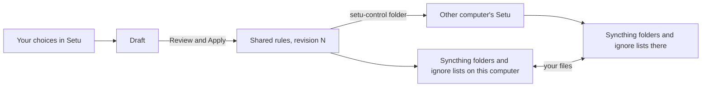

<div align="center">
  
  <h1>Setu</h1>
  <h4>Choose exactly which files and folders sync between two computers, and which way they go.</h4>

  <p>
    
    
    
  </p>

  <p>
    <a href="#-what-it-does">What it does</a> •
    <a href="#-get-started">Get started</a> •
    <a href="#-how-it-works">How it works</a> •
    <a href="#-faq">FAQ</a> •
    <a href="#-for-developers">For developers</a>
  </p>
</div>

Setu is for anyone who keeps one work folder on two computers but does not want *everything*
to go both ways. For example: send all of your laptop's projects to your desktop, but only
let one or two folders come back. Setu shows both computers' files side by side, lets you set a
direction on any folder or file, and shows you exactly what will change before anything does.

Setu is **alpha** software. It does not copy files itself: [Syncthing](https://syncthing.net)
does that, and Setu tells Syncthing what to do. It works with two computers at a time.

> [!WARNING]
> Setu never deletes files when you change a direction or switch a folder off. But Syncthing
> *does* pass deletions along inside a folder that syncs. If you delete a file in a folder set
> to "Both ways", it goes on the other computer too. Syncthing keeps old copies for 30 days in
> each folder's `.stversions` folder, so you can get them back.

## ✨ What it does

- 🧭 **A direction for every folder and file** – Off, Send, Receive or Both ways, set with one
  click. Everything inside a folder follows it unless you choose otherwise.
- 👀 **Both computers in one view** – see what is here, what is there and what is only on one
  side, with sizes, before you decide.
- 📝 **See before you change** – your choices stay a draft until you open the review, read the
  plan and press Apply.
- 🔒 **Secrets never travel** – API key folders, `.env` files and signing keys are always left
  out, whatever you choose. Build and cache folders are left out too.
- 🔢 **Numbered rule changes** – every change to the rules gets a revision number, and each
  computer shows which revision it has applied, so you can tell they agree.
- ↩️ **Nothing lost by changing your mind** – switching a folder off stops syncing it; the files
  stay on both computers.
- 🧱 **Starts with everything Off** – nothing moves until you choose it.
- 🔍 **File-by-file preview** – before the first sync, Setu compares both computers' file lists
  and shows how many files go each way, which ones get replaced, and which stay on one side.
  If many files would be replaced, it asks a second time.
- 🪟 **Windows name check** – names Windows cannot hold (`CON`, `a:b`, trailing dots, very long
  paths, two names that differ only in case) are listed before anything copies.
- 🛑 **Delete guard** – if more than 50 files are deleted on the other computer within two
  minutes, Setu pauses that folder here and tells you, until you resume it.
- 📶 **Network gate** – syncing waits on a metered connection or a slow relayed link, unless you
  allow it.
- ⚖️ **Conflicts, side by side** – when a file changed on both computers, both copies are kept;
  pick the one you want, and the other is put away, not deleted.
- 🕰️ **Old versions for 30 days** – put back any replaced or deleted file from a list.
- ✅ **Check** – one click confirms every synced folder is complete and error-free.
- 🔔 **Notifications and tray** – a desktop notice when a folder is paused, a conflict appears or
  files cannot sync.

## 🚀 Get started

You need [Syncthing](https://syncthing.net/downloads/) running on both computers, and the two
computers paired in Syncthing (each one added as a device on the other).

1. **Install Setu on both computers.** Download it from the
   [Releases page](https://github.com/sudharamachandranrajeev/setu-sync-manager/releases):
   - **Windows:** run `Setu-…-windows-x64-setup.exe`. It is not code-signed yet, so Windows
     SmartScreen may warn: choose **More info**, then **Run anyway**.
   - **Linux:** unpack `setu-…-linux-x64.tar.gz`, open a terminal in that folder and run
     `./install.sh`. It installs for you only (no `sudo`) and adds Setu to the app menu.

   Both start Setu's small background helper at sign-in. It pauses syncing on a metered
   network, stops mass deletions and shows notifications. To leave it out, untick it in the
   Windows installer, or run `./install.sh --no-helper` on Linux.
2. **Pair Setu's control folder.** In Syncthing on both computers, add a folder with the folder
   ID `setu-control`, shared with the other computer. Setu keeps its rules and status there.
   Any empty folder path works.
3. **Open Setu on the first computer.** It asks for the folder to manage (for example
   `/home/you/Work`). Pick it and press **Continue**.
4. **Create the rules, once.** Choose what the other computer runs and press **Create rules**.
   Everything starts Off.
5. **Open Setu on the second computer** and pick its folder (for example `C:\Work`). It picks
   up the same rules through Syncthing.
6. **Choose directions.** Click a folder or file, then pick **Off**, **Send**, **Both ways** or
   **Receive** on the right.
7. **Review and apply.** Press **Review and apply**, read the list and press **Apply**. Then
   open Setu on the other computer and apply there too. A folder starts syncing once both
   computers have applied it.

## 🧩 How it works



- Each folder whose direction differs from the folder around it becomes its own Syncthing
  folder: *send only* on the sending computer, *receive only* on the other, or *send and
  receive* for Both ways.
- Files and folders switched off are added to that Syncthing folder's ignore list. A file can
  have its own direction only when the folder it sits in is Off.
- Setu only touches Syncthing folders whose ID starts with `setu-f-`. If another Syncthing folder
  overlaps a folder Setu manages, Setu stops and tells you instead of guessing.

## ❓ FAQ

<details>
<summary><b>Does Setu send my files anywhere?</b></summary>

No. Files go directly between your two computers through Syncthing. Setu has no server and no
account.
</details>

<details>
<summary><b>What happens if I edit a file on the receiving computer?</b></summary>

The change stays on that computer and is not sent back. Syncthing marks the folder as having
local changes. The sending computer's version wins again if you revert those changes in
Syncthing.
</details>

<details>
<summary><b>Where do replaced and deleted files go?</b></summary>

Into a hidden `.stversions` folder inside each synced folder, kept for 30 days. Open
**Versions** in Setu to put one back. A conflict copy you do not keep goes there too.
</details>

<details>
<summary><b>Can I use Setu with three computers?</b></summary>

Not yet. Setu manages exactly two.
</details>

## 🛠 For developers

Setu is Rust and Svelte 5 in a [Tauri 2](https://tauri.app) window, plus a command-line tool
that does everything the window does.

| Folder | What is in it |
| --- | --- |
| `core/` | Rules, the compiler that turns rules into Syncthing folders and ignore lists, planning and applying |
| `cli/` | The `setu` command and `setu-watch`, the background helper |
| `app/` | The window: Svelte front end in `src/`, Tauri back end in `src-tauri/` |
| `packaging/` | The Linux download (`linux/package.sh`) and the Windows installer (`windows/setu.iss`, Inno Setup) |

```sh
cargo test -p setu-core                         # fast tests
cargo test -p setu-core -- --ignored            # two real Syncthings on this computer (needs syncthing)
cargo run -p setu-cli -- status                 # the command-line tool
cd app && npm ci && npx tauri build --no-bundle # the window
```

The two-Syncthing test starts its own Syncthing instances with temporary folders and ports.
It never touches the Syncthing you use.

A tag such as `v0.1.0` runs `.github/workflows/release.yml`, which builds both downloads and
publishes a GitHub release.

## Licence

MIT. See [LICENSE](LICENSE).
